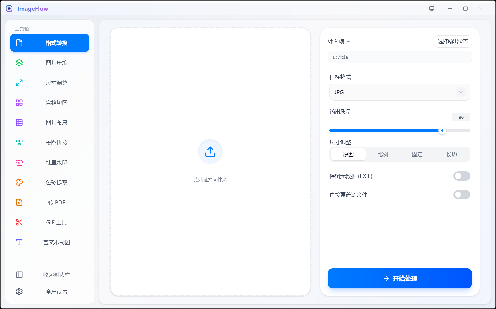
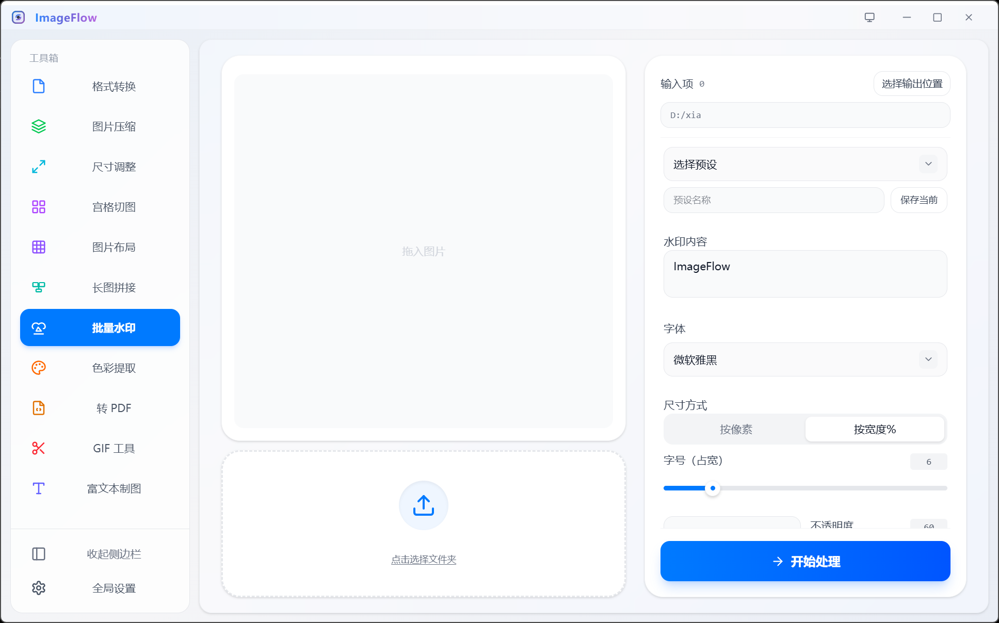
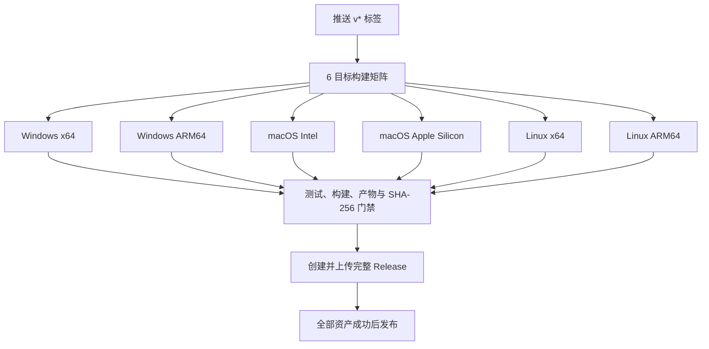

<p align="center">
  
</p>

<h1 align="center">ImageFlow</h1>

<p align="center">
  一套快速、克制、跨平台的桌面图像处理工作台。
  <br />
  11 个完整工具页，覆盖转换、压缩、调整、切图、拼接、水印、取色、GIF、PDF 与富文本制图。
</p>

<p align="center">
  <a href="https://github.com/lllll081926i/Imageflow/releases/latest"></a>
  <a href="https://github.com/lllll081926i/Imageflow/actions/workflows/ci.yml"></a>
  
  
  
  <a href="./LICENSE"></a>
</p>

<p align="center">
  <a href="#下载">下载</a> ·
  <a href="#界面预览">界面预览</a> ·
  <a href="#功能矩阵">功能矩阵</a> ·
  <a href="#自动更新">自动更新</a> ·
  <a href="#开发与构建">开发与构建</a>
</p>

---

## 界面预览

<table>
  <tr>
    <td width="50%"></td>
    <td width="50%"></td>
  </tr>
  <tr>
    <td align="center">格式转换：输出格式、质量、尺寸与元数据控制</td>
    <td align="center">批量水印：样式预设、实时预览与精细参数</td>
  </tr>
</table>

ImageFlow 使用统一的桌面设计语言：清晰的三栏工作区、原生文件选择、即时参数反馈、平滑的分段切换与按钮状态动效。界面支持浅色、深色、跟随系统、透明材质和减弱动态效果。

## 下载

前往 [Releases](https://github.com/lllll081926i/Imageflow/releases/latest) 下载当前版本。安装后的应用名称始终显示为 `ImageFlow`，版本号只写入系统包元数据和文件属性。

| 系统 | 架构 | 推荐安装版 | 免安装版 |
| --- | --- | --- | --- |
| Windows 10 / 11 | x64 | `.exe` | `.zip` |
| Windows 11 on ARM | ARM64 | `.exe` | `.zip` |
| macOS | Intel x64 | `.pkg` | `.zip` |
| macOS | Apple Silicon ARM64 | `.pkg` | `.zip` |
| Debian / Ubuntu 及衍生版 | x64 / ARM64 | `.deb` | `.AppImage` 或 `.tar.gz` |
| Fedora / RHEL / Rocky / AlmaLinux / SUSE 及衍生版 | x64 / ARM64 | `.rpm` | `.AppImage` 或 `.tar.gz` |

文件名中的 `amd64` 表示 x64，`arm64` 表示 ARM64。每个平台同时发布 `SHA256SUMS-<platform>.txt`，可用于独立验证下载内容。

### 安装版与免安装版

- 安装版会写入系统应用目录和卸载信息，并支持在设置页确认后自动下载和启动后续更新。
- Windows 与 macOS 的压缩包、Linux 的 `.tar.gz` 和 `.AppImage` 均属于免安装版。检查到新版本时只会打开官方 Release 页面，由用户手动下载替换。
- AppImage 首次运行前需要赋予执行权限：`chmod +x ImageFlow-*.AppImage`。

## 为什么使用 ImageFlow

- 一个应用完成常见图像工作，不需要在多个网站和工具之间来回切换。
- 文件始终在本机处理，不上传到第三方服务器。
- 批量任务支持并发、取消、失败隔离、冲突策略和统一输出命名。
- 大图、动图和批量缩略图都有内存与像素预算，避免无边界占用。
- 原生支持 Windows、macOS、Linux 的 x64 与 ARM64，不使用跨平台伪编译产物。

## 功能矩阵

| 工具 | 核心能力 |
| --- | --- |
| 格式转换 | JPG、PNG、WebP、AVIF、TIFF、BMP、ICO；SVG 光栅化；比例、固定尺寸、长边缩放；EXIF 保留 |
| 图片压缩 | MozJPEG、pngquant、OxiPNG、WebP；智能档、自定义质量、目标体积、元数据剥离 |
| 尺寸调整 | 固定比例、长边、短边；批量 LANCZOS 重采样；常用预设 |
| 宫格切图 | 四宫格、九宫格、十六宫格；居中裁切；实时分割预览 |
| 图片布局 | 自定义 1–50 行列；正方形裁切或完整覆盖；批量输出 |
| 长图拼接 | 横向、纵向；统一尺寸、间距、背景、边框；输出像素预算保护 |
| 批量水印 | 字体、字号、颜色、透明度、旋转、九宫格、平铺、描边、投影；实时预览与样式预设 |
| 色彩提取 | 主题色与十色色板；导出色板图；与原图拼接输出 |
| 转 PDF | 多图合并、15 种纸张、方向、边距、网格拼版与加密 |
| GIF 工具 | 帧导出、倒放、变速、压缩、缩放；GIF、APNG、WebP 动图互转；透明度与帧时长保持 |
| 富文本制图 | 标题、正文、列表、引用、图片块；6 套主题；画布与排版参数；实时预览 |

全局能力包括输出目录、命名模板、同名冲突策略、并发上限、完成后打开目录、后台托盘、窗口状态记忆、自动检查更新和无障碍动态偏好。

## 体验与性能

### 流畅交互

- 分段控件、开关、按钮、侧栏和状态变化使用统一的弹簧与淡入动效。
- 完整适配 `prefers-reduced-motion`，也可在设置中主动关闭动态效果。
- 文件拖入时只做轻量类型判断，目录展开与缩略图工作让出当前渲染帧，避免拖放瞬间卡顿。
- 缩略图按可见性调度并限制并发，重复请求共享进行中的任务与内存缓存。

### 启动与运行时

- 后端引擎按需加载，启动阶段不预加载图像处理模块。
- 前端按工具页拆分生产包，设置页和详情页延迟加载。
- 批处理使用受控进程池，避免逐文件反复创建进程。
- GIF 帧、预览图、缩略图与最终输出均有尺寸、像素或内存预算。
- 取消任务后不再写入幽灵结果；较旧任务结束时不会覆盖新任务状态。

## 自动更新

ImageFlow 将安装版与免安装版的更新策略明确分开。


- 自动检查使用 6 小时持久缓存和 ETag 条件请求，避免每次进入设置页消耗 GitHub 匿名 API 配额。
- 手动“立即检查”会强制刷新；遇到 `403` 或 `429` 限流时可回退到最近一次可信缓存。
- 下载继承操作系统代理和 `HTTP_PROXY`、`HTTPS_PROXY` 等环境代理设置。
- 用户确认后，后端会重新获取发布元数据，防止检查与下载之间版本被替换。
- 仅接受官方仓库的 HTTPS Release 地址，严格匹配当前系统、架构和包类型。
- 安装器下载到用户缓存目录，声明大小与 GitHub Release 资产 SHA-256 均通过后才会执行。

## 架构

ImageFlow 采用 React + TypeScript 前端、pywebview 桌面宿主和纯 Python 图像后端。平台能力收敛在基础设施层，业务引擎不依赖具体窗口系统。


| 层 | 目录 | 职责 |
| --- | --- | --- |
| 界面 | `frontend/` | 页面、组件、动效、状态与桌面绑定类型 |
| 桌面 API | `backend/api/` | 稳定的前后端调用契约、输入规范化与错误信封 |
| 应用层 | `backend/application/` | 任务生命周期、并发、取消和批处理编排 |
| 引擎层 | `backend/engines/` | 无界面依赖的图像、GIF、PDF 与渲染能力 |
| 基础设施 | `backend/infrastructure/` | 设置、更新、原生对话框、窗口、托盘与平台适配 |
| 发布 | `backend/packaging/` | PyInstaller、EXE、PKG、DEB、RPM、AppImage 与校验清单 |

## 跨平台发布

PyInstaller 不是交叉编译器，因此每个产物都在对应系统和 CPU 架构的 GitHub Hosted Runner 上原生构建。



单次版本发布会生成 22 个资产：

- Windows：2 个架构 × 安装版、便携版、校验清单，共 6 个。
- macOS：2 个架构 × 安装版、便携版、校验清单，共 6 个。
- Linux：2 个架构 × DEB、RPM、AppImage、tar.gz、校验清单，共 10 个。

任一平台的测试、打包或资产校验失败都会阻止正式发布。

## 开发与构建

### 环境

- Node.js 20 或更高版本
- Python 3.10–3.13
- [uv](https://docs.astral.sh/uv/)

Linux 开发环境还需要 GTK 3、WebKitGTK 4.1、PyGObject 的系统构建依赖。

### 安装与启动

```bash
uv sync
cd frontend
npm install
cd ..
uv run imageflow
```

开发启动器会运行 Vite 和 pywebview；前端支持 HMR，后端模块变化后会自动重启桌面宿主。

### 本机发布构建

```bash
uv sync --group build
npm run build:release
```

该命令只构建当前系统和当前 CPU 架构的原生产物，输出到 `artifacts/release/`。完整 6 目标版本由 GitHub Actions 矩阵生成。

可单独构建：

```bash
npm run build:portable
npm run build:installer
```

Windows 安装包需要 Inno Setup 6.3 或更高版本；Linux 发布构建需要 `dpkg-deb`、`rpmbuild` 与 AppImage 构建工具。AppImage 构建器和运行时使用固定版本与固定 SHA-256 下载。

### 质量检查

```bash
npm run test:all
npm run build:frontend
uv run python -m compileall backend
git diff --check
```

后端测试覆盖 API、任务管理、路径安全、内存预算、各图像引擎、更新安全和发布打包。前端测试覆盖桌面运行时、批处理、GIF 参数与错误映射、设置契约和错误边界。

## 配置

| 变量 | 说明 |
| --- | --- |
| `IMAGEFLOW_PREVIEW_MAX_BYTES` | 单个前端预览的文件大小上限 |
| `IMAGEFLOW_MAX_CONCURRENCY` | 覆盖默认批处理并发数 |
| `IMAGEFLOW_SETTINGS_FILE` | 覆盖设置 JSON 路径，父目录必须存在 |
| `IMAGEFLOW_FRONTEND_URL` | 开发模式使用的前端地址 |
| `IMAGEFLOW_DEBUG_TRACEBACK=1` | 调试模式允许错误响应携带 traceback |
| `IMAGEFLOW_GITHUB_REPO` | 覆盖更新检查仓库，默认 `lllll081926i/Imageflow` |
| `HTTP_PROXY` / `HTTPS_PROXY` | Linux 或显式环境代理；Windows 与 macOS 也会读取系统代理 |

默认设置文件位于：

- Windows：`%APPDATA%/imageflow/settings.json`
- macOS / Linux：`~/.config/imageflow/settings.json`

## 输出命名

输出模板支持 `{prefix}`、`{basename}`、`{op}`、`{date:YYYYMMDD}`、`{time:HHmmss}`、`{seq:3}` 等占位符。例如：

```text
{prefix}{basename}_{op}_{date:YYYYMMDD}_{seq:3}
```

同名文件可以选择自动重命名、直接覆盖或跳过。批处理会提前解析整组输出路径，避免并发任务产生相互冲突的文件名。

## 贡献

欢迎提交 Issue 与 Pull Request。提交前请执行全量测试、类型检查、生产构建和 `git diff --check`，并为行为变化补充回归测试。

## 作者与许可

ImageFlow 由 [lllll081926i](https://github.com/lllll081926i) 维护，基于 [MIT License](./LICENSE) 发布。
