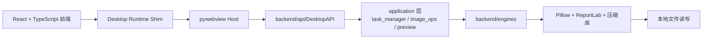
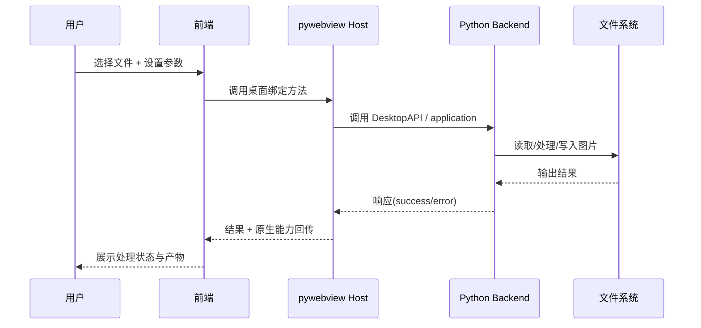

<p align="center">
  
</p>

<h1 align="center">ImageFlow</h1>

<p align="center">
  一款面向桌面端的图像处理工作台：11 个工具页覆盖转换、压缩、切图、拼接、水印、色板、GIF 与 PDF。
</p>

<p align="center">
  
  
  
  
  
</p>

---

## 项目定位

ImageFlow 当前采用 **纯 Python 后端 + React 前端 + pywebview 宿主** 架构：
- **backend/main.py**：桌面应用入口，负责窗口启动与宿主生命周期。
- **backend/api/**：统一对前端暴露的桌面 API，保持原有调用面兼容。
- **backend/application/**：任务管理、批处理、预览与执行编排。
- **backend/engines/**：图像能力引擎，负责转换、压缩、分割、水印、拼接、色板、富文本、GIF、PDF 等核心处理。
- **React**：macOS 风格界面，弹簧动效体系与可开关的毛玻璃材质。
- **pywebview**：提供桌面窗口、原生对话框与拖拽桥接。

适用场景：
- 批量格式转换、压缩、尺寸调整
- 切图产出（宫格 / 自定义行列）与长图拼接
- 批量加水印、色彩提取、富文本制图
- 动图和文档产出（GIF、PDF）

---

## 功能页总览（v2.2）

| 页面 | 能力要点 | 预设 |
|---|---|---|
| 格式转换 | JPG/PNG/WEBP/AVIF/TIFF/BMP/ICO 输出；SVG 光栅化；缩放三模式；EXIF 保留 | — |
| 图片压缩 | JPEG(MozJPEG)/PNG(pngquant+OxiPNG)/WEBP；智能档 + 目标体积 + **自定义质量**；元数据剥离 | — |
| 尺寸调整 | 固定比例 / 长边 / 短边，批量 LANCZOS | ✅ |
| 宫格切图 | 四 / 九 / 十六宫格，实时分割预览 | — |
| 图片布局 | 自定义行×列（1–50）；优先正方形（舍弃余料）/ 完整覆盖两种模式；批量 | ✅ |
| 长图拼接 | 纵向 / 横向；统一宽高、间距、背景色；单张加边框；上限 16000px / 256MP | ✅ |
| 批量水印 | 字体 / 字号（像素或占宽）/ 颜色 / 不透明度 / 旋转 / 九宫格 / 平铺 / 描边 / 投影；实时预览 | ✅ 样式预设 |
| 色彩提取 | 主题色 + 十色色板；导出色板图或拼接在原图下方 | — |
| 转 PDF | 多图合并、15 种纸张、网格拼版、加密 | — |
| GIF 工具 | 帧导出（PNG/JPG/WEBP/BMP/TIFF）、倒放、变速、压缩、缩放、互转 APNG/WEBP | — |
| 富文本制图 | 标题/正文/列表/引用/图片块；6 套内置主题；画布样式随心定制；实时预览 | ✅ 模板 |

全局能力：批量并发可调、输出命名模板、冲突策略（重命名/覆盖/跳过）、失败重试、完成卡片一键打开目录、后台运行（托盘）、外观（透明效果 / 减弱动态）、窗口记忆。

---

## 图解架构





---

## 功能矩阵（图文版）

| 模块 | 主要能力 | 关键实现 |
|---|---|---|
| 格式转换 | JPG/PNG/WEBP/AVIF/TIFF/BMP/ICO/SVG 等；缩放/长边/固定尺寸；可选保留 EXIF | `backend/engines/converter.py` |
| 图片压缩 | 多档压缩策略；可指定目标体积 | `backend/engines/compressor.py` |
| 转 PDF | 多图合并 PDF；页面尺寸、方向、边距 | `backend/engines/pdf_generator.py` |
| GIF 工具 | 导出、倒放、调帧率、压缩、缩放、互转 | `backend/engines/gif_splitter.py` |
| 全局设置 | 路径、命名模板、并发、自动检查更新、窗口记忆 | `backend/infrastructure/settings_store.py` |

## 技术栈与依赖

### 前端
- React `19.x`
- TypeScript `5.x`
- Vite `6.x`
- Tailwind CSS `4.x`

### 后端
- pywebview `6.x`
- uv（Python 依赖与运行管理）

### Python 图像栈
- Python `>=3.10`
- Pillow
- reportlab
- resvg-py（SVG 光栅化）
- mozjpeg-lossless-optimization / imagequant / pyoxipng（压缩增强）

---

## 目录结构

```text
Imageflow/
├── frontend/                    # React + Vite UI
│   ├── components/              # 核心界面组件
│   ├── runtime/                 # 桌面宿主运行时兼容层
│   ├── types/                   # 前后端绑定与模型定义
│   └── ...
├── backend/                     # 纯 Python 后端
│   ├── api/                     # 前端可调用 API
│   ├── application/             # 应用编排与任务管理
│   ├── domain/                  # 领域路径与规则
│   ├── infrastructure/          # 对话框、设置、窗口控制
│   ├── host/                    # pywebview 宿主接线
│   ├── engines/                 # 图像能力引擎
│   ├── testdata/                # 测试数据
│   ├── tests/                   # 后端与引擎回归测试
│   └── main.py                  # pywebview 应用入口
├── docs/                        # 架构与需求文档
├── pyproject.toml               # Python依赖（uv）
└── README.md
```

---

## 快速开始

### 1) 环境准备

- Node.js（建议 LTS）
- Python `3.10+`
- uv

### 2) 安装依赖

```bash
# 前端依赖
cd frontend
npm install

# Python 依赖（推荐）
cd ..
uv sync
```

### 3) 启动开发

```bash
# 根目录一条命令启动开发模式
uv run imageflow
```

该命令会自动启动 Vite 前端开发服务器和 pywebview 桌面宿主。前端页面支持 Vite HMR，`backend/**/*.py`（除 `engines/` 独立模块）变更后会自动重启 Python 宿主。

> 等价旧命令：`npm run dev`（Node 版启动器，行为一致）。

### 4) 构建发布

```bash
# 同步 Python 运行与打包依赖
uv sync --group build

# 构建便携版 zip 和 Inno Setup 6 安装版
npm run build:release
```

发布产物输出到 `artifacts/release/`：

| 产物 | 文件名格式 | 说明 |
|---|---|---|
| 便携版 | `ImageFlow-portable-<version>-windows-amd64.zip` | 解压后直接运行 `ImageFlow.exe` |
| 安装版 | `ImageFlow-setup-<version>-windows-amd64.exe` | Inno Setup 6 安装器 |

也可以单独构建：

```bash
# 仅构建便携版
npm run build:portable

# 仅构建安装版
npm run build:installer
```

安装版构建依赖 Inno Setup 6。若 `ISCC.exe` 不在系统 `PATH` 中，可设置：

```bash
export INNO_SETUP_ISCC="C:/Program Files (x86)/Inno Setup 6/ISCC.exe"
```

本地只验证发布态运行时，可先执行 `npm run build:frontend`，再运行：

```bash
uv run python -m backend.main
```

---

## 支持格式（当前代码实现）

### 普通处理输入（转换、压缩、PDF、GIF 工具、布局、水印、色板）
- `jpg`, `jpeg`, `png`, `webp`, `gif`, `bmp`, `avif`, `heic`, `heif`, `ico`, `tiff`, `tif`, `svg`（SVG 仅转换/预览光栅化）

### 转换输出（转换模块）
- `jpg`, `jpeg`, `png`, `webp`, `bmp`, `tiff`, `tif`, `ico`, `avif`

### GIF 帧导出格式
- `png`, `jpg`, `webp`, `bmp`, `tiff`

---

## 并发与性能设计

- 默认并发按 CPU 自动推导（Windows 上限 `4`，其他平台上限 `8`），可在设置中调节 `1-32`。
- `backend/application/image_ops.py` 基于 `ProcessPoolExecutor` 调度多进程执行。
- 批处理取消为协作式：已开始的单项会执行完毕，未开始的项会被跳过并标记为已取消。
- 大图预览支持阈值控制，防止前端内存飙升。

---

## 配置说明

### 环境变量

| 变量名 | 说明 |
|---|---|
| `IMAGEFLOW_PREVIEW_MAX_BYTES` | 预览文件大小阈值（字节） |
| `IMAGEFLOW_PROFILE=1` | 打开 Python 侧性能/能力检测日志 |
| `IMAGEFLOW_SETTINGS_FILE` | 测试或特殊环境覆盖设置文件路径，必须指向已存在目录下的 `.json` 文件 |
| `IMAGEFLOW_FRONTEND_URL` | 开发模式下指定 pywebview 加载的前端地址 |
| `IMAGEFLOW_DEBUG_TRACEBACK=1` | 调试模式下允许后端错误响应包含 traceback |

### 全局设置（UI）

| 字段 | 默认值 | 说明 |
|---|---|---|
| `max_concurrency` | 按 CPU 推导（Windows 最多 `4`，其他平台最多 `8`） | 并发数，范围 `1-32`，可用 `IMAGEFLOW_MAX_CONCURRENCY` 覆盖默认值 |
| `output_prefix` | `IF` | 输出前缀 |
| `output_template` | `{prefix}{basename}` | 输出命名模板 |
| `preserve_folder_structure` | `true` | 保留原目录层级 |
| `conflict_strategy` | `rename` | 冲突处理策略：`rename` 自动重命名 / `overwrite` 直接覆盖 / `skip` 跳过同名 |
| `open_output_folder_on_complete` | `false` | 完成后自动打开输出目录 |
| `ui_transparency` | `true` | 毛玻璃/亚克力材质（关闭回退纯色，更省电） |
| `ui_reduced_motion` | `false` | 减弱动态效果（关闭所有弹簧动画） |
| `background_running` | `false` | 后台运行：点关闭隐藏到系统托盘 |

设置文件位置：`os.UserConfigDir()/imageflow/settings.json`  
Windows 常见路径示例：`C:/Users/<用户名>/AppData/Roaming/imageflow/settings.json`

---

## 输出命名模板

`output_template` 支持占位符（模板展开在前端 `frontend/components/DetailView.tsx` 侧完成，后端仅存储该设置）：

| 占位符 | 说明 | 示例 |
|---|---|---|
| `{prefix}` | 输出前缀（会自动追加下划线） | `IF_` |
| `{basename}` | 原文件名（不带扩展名） | `photo_001` |
| `{op}` | 操作类型 | `convert` |
| `{date:YYYYMMDD}` | 日期格式化 | `20260220` |
| `{time:HHmmss}` | 时间格式化 | `235959` |
| `{seq:3}` | 序号补零 | `001` |

示例模板：

```text
{prefix}{basename}_{op}_{date:YYYYMMDD}_{seq:3}
```

---

## 测试与质量检查

```bash
# Python 单元测试（含 application + engines，因 engines 已是包）
uv run python -m unittest discover -s backend/tests -v
# 等价：
npm run test:backend

# pytest（dev 依赖组）
uv run pytest backend/tests -q

# 仅引擎回归
uv run python -m unittest discover -s backend/tests/engines -v
# 等价：
npm run test:backend:engines

# 发布配置回归测试
uv run python -m unittest backend.tests.test_release_builder -v

# 前端测试 / 类型检查 / 构建
npm run test:frontend
npm run typecheck:frontend
npm run build:frontend
```

---

## 常见问题（FAQ）

### 1. 启动时找不到 Python
- 先执行 `uv sync` 创建 `.venv`
- 从仓库根目录使用 `uv run python -m backend.main` 或 `npm run dev` 启动，确保使用 uv 管理的 Python 环境

### 2. 找不到 Python 脚本目录
- 检查 `backend/engines` 是否完整
- 先执行 `uv sync`，确保 `.venv` 和依赖已同步

### 3. 打包后界面空白或资源缺失
- 先执行 `cd frontend && npm run build`
- 再执行 `uv run python -m backend.main`

### 4. 批量任务速度不稳定
- 调整 `max_concurrency`（通常 4-16 更稳）
- 关闭不必要的大图预览，降低内存压力

---

## 开发文档

- **设计系统（样式与动效契约）：`docs/DESIGN.md`**
- 后端架构：`docs/BACKEND_ARCHITECTURE.md`
- 后端说明：`docs/BACKEND_README.md`
- 压缩方案：`docs/image-compression.md`
- 综合需求：`docs/ImageFlow 综合需求文档.md`
- 开发指南：`docs/ImageFlow_Development_Guide_Final.md`
- 迁移设计：`docs/superpowers/specs/2026-04-17-python-backend-migration-design.md`
- 迁移计划：`docs/superpowers/plans/2026-04-17-python-backend-migration.md`

---

## 贡献建议

欢迎提交 Issue / PR。推荐流程：

1. Fork 并创建特性分支
2. 补充对应测试（优先 Python 处理脚本测试）
3. 提交前执行构建与测试
4. PR 中附上改动说明和验证步骤

---

## License

本项目采用 **MIT License**，详见 `LICENSE`。
