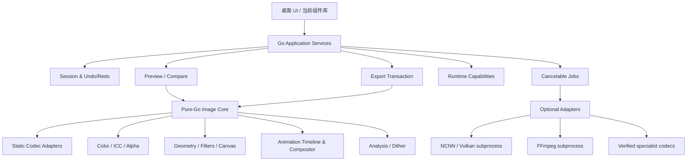

# Go 图片工具箱 · 技术架构与接口契约（候选实施设计）

> **2026-11-17 仓库适配修订**：软件基线为 `v3.1.0`，不是本包版本号。先读 [M0 仓库对齐与增量实施基线](../04_实施与测试/M0_仓库对齐与增量实施基线.md)。本次只优化规划；源码核查、历史测试、人工验收和性能实测分别记录。

> 依据 PRD v2.0 第 5、11–13、15 章和《开发规范 v1.0》编写。**此文件提出可实施的模块边界与数据契约，不声称已与现有工程兼容**。真实目录、Go 版本、GUI 框架、编码器必须 M0 识别后采用 ADR 锁定。核心处理 Go 原生优先，外部组件单独隔离。

## 0. 强制技术边界

1. Go 承担核心处理、状态、导出和任务；禁止为了常规 JPEG/PNG/裁剪/调色强制部署 Python、FFmpeg、CGO 或 NCNN。
2. 对不可合理用纯 Go 完成的 AI、视频、特种编码，使用可选适配器。缺失组件时主功能仍正常使用。
3. 只构建**工具内**多图处理；不建用户可见 CLI/API、跨工具工作流与管理中心。
4. 实际格式支持必须来自 `CodecCapability` 检测和端到端测试，不把解码与编码混为一谈。
5. 所有编辑和导出均默认源图只读，成功反馈以输出文件校验为准。

## 1. 推荐的分层结构



- **UI** 不直接操纵 Go 第三方包，避免开发画布和后续换壳时重新实现算法。
- **应用服务层** 负责参数合法性、图像会话、命令历史、能力检测、任务状态和事件发布。
- **图像核心** 只提供确定性操作，处理必要的像素/颜色/动画语义。
- **导出事务** 必须具备文件写入、复核、提交、失败清理、目标冲突处理。
- **可选适配器** 在独立入口加载，具备版本探测、故障隔离、取消/杀进程、授权审查。

## 2. 建议目录（示意，不要求对现有仓库硬迁移）

```text
cmd/desktop/                  # 桌面宿主启动
internal/app/                 # 服务组装与事件桥
internal/assets/              # SourceAsset 导入、头检测、元信息
internal/capabilities/        # Codec/Engine 动态能力快照
internal/session/             # 编辑会话、操作序列和撤销重做
internal/preview/             # 低清与全清预览缓存、取消旧任务
internal/imagecore/codec/     # 静态解码编码；受检验的独立驱动
internal/imagecore/geometry/  # 裁剪、缩放、旋转、蒙版
internal/imagecore/color/     # 色彩空间、ICC、Gamma、Alpha
internal/imagecore/filters/   # 传统滤镜、LUT
internal/imagecore/canvas/    # 文字、图层、排版、形状、水印
internal/imagecore/animation/ # 帧规范、合成、动图读写适配
internal/imagecore/analysis/  # 直方图、PSNR/SSIM、像素色采样
internal/imagecore/dither/    # 量化和抖动、黑白点阵
internal/export/              # 输出格式选择、临时文件、原子提交能力
internal/optional/upscale/    # AI 推理接口、独立子进程适配
internal/optional/video/      # 可选视频帧提取
internal/optional/svgtrace/   # P2 的 SVG 描摹
internal/security/            # 资源预算、输入约束、进程执行策略
internal/diagnostics/         # 版本、错误码、性能采样
frontend/ or ui/              # 按 M0 现有项目实际决定
assets/fixtures/              # 合成与获许可测试样本
```

## 3. 基础接口定义（逻辑契约）

以下是说明接口职责的 Go **设计示例**，不是已编译、已接入项目的源代码。

```go
type ImageInfo struct {
    ID string
    Path string
    Format string
    Width, Height int
    Frames int
    BitDepth int
    HasAlpha bool
    ICCProfile string
    EXIFOrientation int
    Bytes int64
}

type CodecCapability struct {
    Format string
    Decode, Encode bool
    AnimatedDecode, AnimatedEncode bool
    Alpha, ICC, Metadata bool
    RequiresOptional bool
    ReasonUnavailable string
}

type Operation struct {
    ID string
    Version int
    Enabled bool
    Kind string
    Params []byte // 版本化 JSON；由具体算法解码/校验
}

type RenderRequest struct {
    AssetIDs []string
    Operations []Operation
    PreviewMaxEdge int
}

type RenderResult struct {
    Width, Height, Frames int
    PreviewRef string
    Warnings []string
}

type AppError struct {
    Code string
    Message string
    Remediation string
}
```

`Operation.Params` 要有明确 schemaVersion、字段范围和默认值；不得传入未经校验的任意路径或 shell 参数。可用 `json.RawMessage` 或类型化参数结构实现，具体在 ADR 定稿。

### 3.1 编解码器

- `Probe(path) -> ImageInfo + CodecCapability`：依据魔数、头部与解码验证，不能只看扩展名。
- `Decode(ctx, source, framePolicy) -> Pixels/FrameSequence`：`ctx` 可取消；将静态与动图分开。
- `Encode(ctx, content, opts, writer) -> EncodedReport`：编码器声明能够真正输出的位深、动画、Alpha、ICC。
- 动图编码器必须按已验证语义处理 disposal、duration、loop、offset、blend；不能把第一帧当整段动图。
- 高级格式（AVIF/HEIC/JXL）不承诺“自动支持”；经过构建、授权、功能回归后才注册。

### 3.2 会话和操作管线

`SourceAsset（源图只读） → Operations（参数序列） → PreviewCache（缩图） → FullRender（原尺寸） → ExportTransaction`。

- 编辑只修改操作树和游标（撤销/重做），不重复对已 JPEG 编码结果进行二次有损编辑。
- 预览与导出使用同一算法的不同尺寸/资源策略；计算不同的滤镜时，需要定义边界条件和缩放比例语义。
- 当用户连续拖滑块时，取消/废弃旧任务；新参数产生新 `revision`，结果回填需核对 `revision` 一致。
- 图片布局、标注、富文本等采用共享的图层与画布对象模型；不复刻多套文本或混合算法。
- 每个缓存项定义 source hash/mtime、操作版本、目标预览尺寸、色彩模式、算法版本组成 cache key。

### 3.3 动画内部数据模型

```go
type Frame struct {
    PixRef string
    DurationNumerator, DurationDenominator int
    X, Y int
    BlendMode string
    DisposalMode string
}

type FrameSequence struct {
    CanvasW, CanvasH int
    Frames []Frame
    LoopCount int // 0 等含义必须依据具体格式适配器明确转换
}
```

内部保留原始动画语义，同时生成“可显示完整帧”供编辑和预览。输出动画时按目标格式重新编码，禁止丢失不均匀帧时长。不同格式 loop=0 可能语义不同，适配器需要对照规范逐项转换。

## 4. Go 原生实现策略（按优先顺序验证）

| 能力 | 默认方向 | 验证重点 | 状态 |
|---|---|---|---|
| JPEG/PNG/GIF 静态基础 | 保留当前 codec、jpegli 和 OxiPNG，按模式复用标准库 | 批量耗时、位深、质量参数 | 既有实现 |
| 处理缩放、裁剪和旋转 | `golang.org/x/image/draw`、`disintegration/imaging` | resample 品质、EXIF orientation | 推荐起点 |
| 传统滤镜/颜色调整 | `disintegration/gift`、部分纯 Go 算法 | 精度、Alpha、Gamma 与性能 | 推荐候选 |
| 图像通道/直方图与形态学 | `anthonynsimon/bild` 或内部算法 | 其主分支 Go 版本要求、内存分配 | 可选 PoC |
| WebP/APNG 动图与 ICC | 保留现有 APNG/libwebp 与 LCMS/WASM | 补充高位深、时序和边界矩阵 | 已有实现，增量补证 |
| 文字/图层 | Go 字体/矢量绘图库、精简内部渲染 | CJK shaping、字重、字体许可和测量 | PoC 阻断 |
| AI 放大 | 独立 `Real-ESRGAN-ncnn-vulkan` | 引擎版本、GPU、模型许可证 | 可选组件 |
| 视频帧提取 | FFmpeg 独立进程 | 封装、许可、帧时间戳与包大小 | P2 可选 |
| 彩色 SVG 描摹 | 专项适配器如 VTracer | 输出真实 Path、许可证和分发 | P2 可选 |

**特别说明**：`kovidgoyal/imaging` README 公开列明 APNG、动态 WebP、ICC/EXIF 和对未知格式向 ImageMagick fallback，但上游 `go.mod` 标注 Go 1.26；不得以 `README` 代替实际编码解码回归与项目版本兼容测试。`anthonynsimon/bild` 当前主分支 `go.mod` 标注 Go 1.25；采用前锁定具体版本。

## 5. 色彩与 Alpha 设计

- 读入有 EXIF Orientation 的图片：转换像素方向后更新/清除方向标记，避免二次旋转。
- 同步遵循 ICC 输入→工作空间→输出 ICC/明确转换的颜色政策。不能把“忽略 ICC”的路径用于宣称专业准确的调色。
- 优先定义预乘 Alpha、颜色空间及滤镜工作空间；高质量缩放/模糊应避免在不合适的非预乘颜色值上插值造成黑边。
- 颜色分析工具必须说明是在原始像素编码、线性工作空间还是输出 sRGB 中取样。
- 调色预设保存算法版本、工作空间、参数范围；升级算法时能明确识别旧预设的渲染差异。
- 无法实现高精度 ICC、16-bit/float 路径时，只可标注受限的 8-bit 处理模式；不能直接宣称完整专业色彩管理。

## 6. 导出事务、安全与资源预算

### 6.1 导出生命周期

1. 校验源图与参数，检查目标目录是否存在、目标文件是否冲突、输出格式是否真实可编码。
2. 估计解码/处理/输出阶段可能的像素与帧内存；与配置/设备预算比对，超限拒绝或降级预览。
3. 在目标目录写随机临时文件，编码完成后 `close` 并检查错误。
4. 重新解码或至少深入检查输出头/目标帧、尺寸、可读性；对关键成果可以做完整解码验证。
5. 正式提交文件；**Windows 替换已存在文件的原子语义需专项实现测试**，绝不假设 `os.Rename` 完全可靠。
6. 仅成功后才展示 SUCCESS；失败取消清理临时文件并保留源图不变。

### 6.2 图片资源预算

- 先探测宽高、帧数与位深，再估算最小像素缓冲开销；不要先分配、出错再补救。
- 基础 RGBA 8-bit 约 `width×height×4` 字节，仅是单个缓冲的下界；预览/副本/滤镜/直方图/Go GC 会增加峰值。
- 对异常高的像素数、帧数或不可置信文件头做显式拒绝；极窄长图和动画须独立预算。
- 导入不可信 SVG、GIF、ICO 和异常 ICC 时需要额外 fuzz 与尺寸约束。
- 操作级/任务级 Context cancellation；GPU 进程、FFmpeg 进程及临时文件统一由会话任务持有，避免泄漏。

## 7. 错误与诊断事件

| 错误码 | 产生位置 | UI 恢复动作 |
|---|---|---|
| CORRUPT_IMAGE | 探测或解码失败 | 提示文件损坏/尝试更换 |
| UNSUPPORTED_DECODE / ENCODE | codec 能力与构建不匹配 | 显示可支持格式或可选组件 |
| INVALID_COLOR_PROFILE | ICC 数据不合法 | 明示有限精度转换或拒绝 |
| TOO_LARGE | 分配前资源预算超限 | 建议更小目标/分段处理 |
| EXPORT_PERMISSION / DISK_FULL | 写入失败 | 重选目录/清理磁盘 |
| MODEL_MISSING / GPU_UNAVAILABLE | AI 加载失败 | 模型安装/显卡诊断 |
| ENGINE_FAILED | NCNN 子进程失败 | Tile 调整/错误详情 |
| CANCELLED | 用户取消 | 清理部分输出并恢复当前会话 |

本地日志仅记录错误类别、状态阶段、算法版本和必要耗时；默认不上传图片与用户路径。用户主动开启详细调试时必须显示隐私警告。

## 8. 前端壳决策

- 如果现有前端运行稳定，优先保留并让 Go Core 提供任务能力；避免为了“Go 原生”重写画布/动图时间轴。
- Wails 使用系统 WebView（不是 Electron 打包 Chromium），但仍需统计 WebView 进程内存，不能标作纯原生控件。
- 当前保留 MyGo + Lobe MyGo。Fyne/Wails 等只作历史参考，不进入本轮任务。
- 任何换壳提案必须包括冷启动 P50/P95、空闲 RSS、CPU、首屏预览、拖动交互、构建包体积、开发工作量与迁移风险对比。

## 9. 关键 ADR（当前接入决策见 §11）

| ADR | 决策问题 | 选择依据 | 决策者/状态 |
|---|---|---|---|
| ADR-001 | 现有 UI 保留还是换壳 | 当前 MyGo 与既有回归 | 本次保留，见 §11 |
| ADR-002 | 主图像内核与格式 codec | Go 版本、格式能力、性能、许可 | 待定 |
| ADR-003 | ICC/Alpha 工作空间 | 准确性、可重现性、性能 | 待定 |
| ADR-004 | 动态 WebP/APNG 真实读写 | 动画语义、license、Go 版本 | 待定 |
| ADR-005 | 导出原子提交机制 | Windows 实际文件系统行为 | 待定 |
| ADR-006 | AI 推理引擎和模型集 | NCNN 功能、GPU、许可、权重来源 | 待定 |
| ADR-007 | 基础包与可选组件分发 | 体积、独立卸载、故障隔离 | 待定 |
| ADR-008 | 性能发布门槛 | 当前版本实测基线与目标人群设备 | 待定 |

## 10. 发布前硬阻断项

- 真实编解码能力矩阵及其测试报告可生成；不能显示未支持格式。
- P0 导出与源图完整性回归全通过，失败/取消无伪成功文件。
- ICC/透明/EXIF/复杂 GIF 有回归证据；实现受限时明示能力。
- 全部第三方库、模型、可执行程序、字体都有版本、来源、许可和再分发审查记录。
- 在干净 Windows 10/11 x64 环境验证安装、升级、删除扩展组件与旧设置迁移。
- 高风险异常输入、GPU OOM、磁盘满、取消任务均不会导致系统长期无响应。

## 11. 当前仓库接入约束（2026-11-17）

上述目录、结构体和错误码是目标逻辑契约，不是要求整体替换现有代码。复用 `internal/codec`、`internal/engine`、`internal/batch`、`internal/output` 和 `internal/ui`；通过适配扩展 Result 与 Session。

- ADR-001：本次保留 MyGo + Lobe MyGo；Wails/Fyne 仅为历史候选，不进入当前任务。
- ADR-002：保留已锁定编解码器和压缩链；只有明确缺项、性能或维护证据才评估新库。
- ADR-003：复用 LCMS/WASM 和已有 ICC 路径；高精度/线性工作空间另外验证。
- ADR-004：复用现有 APNG/动态 WebP 与动画合成回归；补缺失边界，不重复立项实现。
- ADR-005：复用现有原子写基础；文件系统错误注入和跨平台覆盖语义仍需验证。
- ADR-006/007：AI 引擎、权重及分发仍待独立审查；保留已有签名更新和六平台构建。
- ADR-008：性能尚未实测，不设未经测量的换壳或提速结论。

UI 后台任务通过 `Window.Update` 提交，并校验输入身份、运行代数和窗口生命周期。禁止在后台保存 `ui.Context`、跨帧 Element 或直接改写 UI 状态。新操作会话不能替换既有批次身份机制。

新增工具前迁移 `RailOrder []int`，使用稳定工具 ID 映射旧索引；先验收旧设置和拼图参数往返，再改变导航。所有源码路径相对仓库根目录。详见 M0 基线。
