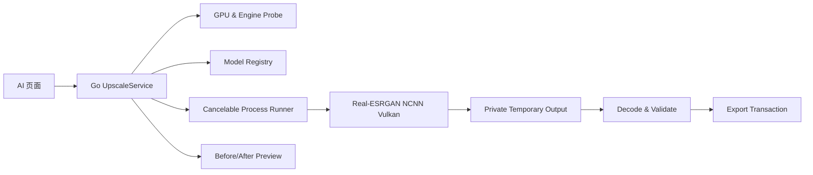

# Upscayl 类 AI 高清放大：Go 集成、模型兼容和合规专项方案

> **2026-11-17 仓库适配修订**：软件基线为 `v3.1.0`，不是本包版本号。先读 [M0 仓库对齐与增量实施基线](../04_实施与测试/M0_仓库对齐与增量实施基线.md)。本次只优化规划；源码核查、历史测试、人工验收和性能实测分别记录。

> 需求对应 `AI-01`；属于独立可选组件，**不是整个图片工具箱的强制安装依赖**。调研依据：Upscayl 官方仓库的 `package.json`、`electron/utils/spawn-upscayl.ts`、`electron/utils/get-arguments.ts`、`electron/commands/image-upscayl.ts`、`common/models-list.ts`、`upscayl-ncnn` 项目和 Real-ESRGAN-ncnn-vulkan 官方 README/LICENSE（链接见文末）。源代码主分支内容会变化；实际开发必须锁定 commit/tag 并复验。本方案不是法律意见。

## 1. 结论先行

- Upscayl 的 Electron **不是** AI 推理算法主体。官方桌面宿主通过 `child_process.spawn()` 启动独立 `upscayl-bin`，本地后端主要涉及 NCNN/Vulkan。因而将主程序流程迁移到 Go，可以降低部分宿主框架运行和集成开销，但在相同模型/GPU/后端下**不能凭语言变化保证模型推理更快**。
- 推荐用 `Go 调度器 + 原生 NCNN/Vulkan 推理二进制 + 可选模型目录 + 可校验本地输出`。这满足“Go 原生优先、复杂推理允许其他支持库”的要求。
- Upscayl 主仓库与 `upscayl/upscayl-ncnn` 的 LICENSE 为 AGPL-3.0；`xinntao/Real-ESRGAN-ncnn-vulkan` 的项目 LICENSE 为 MIT。二者 CLI、模型集与其他依赖**不应视为相同**。
- 优先以 MIT 的 Real-ESRGAN NCNN 实现完成可选集成；如目标是完全复用 Upscayl 模型/功能，必须对模型格式、推理架构、CLI、权重许可证另行验证，不能简单把 Upscayl 资源复制过来。
- “Go 原生”在此指 UI 宿主/任务逻辑/预览和导出以 Go 为核心，而不是试图用 Go 重新实现 Vulkan 推理或声称推理引擎是纯 Go。

## 2. 已核对的上游事实

| 事实 | 源文件/官方位置 | 实施含义 |
|---|---|---|
| 桌面前端使用 Electron/Next | `upscayl/upscayl/package.json` | 可以单独替换 UI 与任务调度，不影响模型设计原理 |
| 通过 `spawn` 执行独立的 `upscayl-bin` | `electron/utils/spawn-upscayl.ts` | Go 可用 `exec.CommandContext` 类方式托管子进程 |
| Upscayl CLI 装配包含 `-i -o -m -n -g -f -w -c -t -x` 等选项 | `electron/utils/get-arguments.ts` | **这些不是所有 Real-ESRGAN CLI 都支持的参数** |
| 内建模型列出 standard/lite/high-fidelity/remacri/ultramix/ultrasharp/digital-art 等命名 | `common/models-list.ts` | 模型展示需以实际已安装且兼容的文件为准 |
| 官方 README 强调需要 Vulkan 兼容 GPU | `upscayl/upscayl/README.md` | 无兼容 GPU 时不显示 AI 可直接运行 |
| 官方 Upscayl 及其 NCNN fork 为 AGPL-3.0 | 两仓库 LICENSE | 不能不经审核直接复制/嵌入/二次分发 |
| Real-ESRGAN-ncnn-vulkan 有独立 CLI 和 MIT 项目许可证 | 该项目 README/LICENSE | 可作为首选引擎验证，但模型权重与依赖需独立审查 |

## 3. 产品范围

### 3.1 本次 P1 必须实现

1. 不安装 AI 组件时，主程序启动、图片转换、压缩、调色、GIF 等全部独立工作。
2. 能检测可用引擎、GPU/驱动兼容性与模型状态，并显示明确的错误原因。
3. 在本地选择单张图片、模型、目标倍数；实现输入尺寸、目标尺寸和显存风险提示。
4. 支持必要的 GPU/Tile 选择；TTA 仅当已安装后端真实支持时启用。
5. 支持取消任务、退出程序时回收子进程、失败清理输出和重试。
6. 提供局部放大前后对比、导出结果校验和源图安全保护。
7. 模型安装/导入/移除必须带来源、哈希、许可信息和空间占用。

### 3.2 不属于本次保证范围

- CPU 模式无条件后备；Real-ESRGAN NCNN Vulkan 通常依赖 Vulkan 环境。
- 各种未知第三方模型都能导入；模型兼容必须做逐型号验证。
- 任意倍率由 AI 原生支持；非模型原生倍率应由推理后正常缩放并告知用户。
- 视频实时超分、AI 文生图、旧照片精细修复、对象擦除、完整抠图。
- 默认将 AI 引擎与权重打入基础安装包。

## 4. 建议架构



**接口角色**：

- `EngineProbe`：寻找可信执行文件（固定受信任目录或用户选择后审核）、查询版本、做低成本引擎探测；不得只凭 exe 存在判定 GPU 可用。
- `ModelRegistry`：每个模型记录 ID、hash、格式、原生倍率、适用类型、引擎兼容范围、许可证与来源。
- `UpscaleService`：把用户请求解析为特定引擎支持的参数；算法默认与高级参数分离。
- `ProcessRunner`：安全调用绝对路径与参数数组，不用 shell；管理超时、取消、标准错误、子进程组和退出码。
- `OutputVerifier`：验证文件确实存在、能打开、尺寸匹配、结果不为空/不损坏，然后交由正常导出事务提交。

## 5. Real-ESRGAN NCNN 参数适配

官方 README 中包含：

| 参数 | 作用 | UI 归属 |
|---|---|---|
| `-i` | 输入文件/路径 | 导入与本地临时源 |
| `-o` | 输出文件/路径 | 临时输出；正式路径通过 ExportTransaction |
| `-s` | 放大倍率（具体有效值以当前后端校验） | 倍率与输出尺寸 |
| `-t` | Tile 大小 | 高级/显存优化 |
| `-m` | 模型目录 | 模型管理 |
| `-n` | 模型名称 | 模型列表 |
| `-g` | GPU ID | 高级/设备选择 |
| `-j` | 加载:处理:保存并发度 | 高级/诊断模式，可限制资源 |
| `-x` | TTA | 高级质量模式 |
| `-f` | 目标格式 | 只允许真实支持的格式 |

**禁止**将 Upscayl fork 中 `-w`（指定宽度）、`-c`（压缩配置）直接传给原版 Real-ESRGAN CLI；后者 README 不宣称支持这些相同选项。自定义目标宽高应在推理结束后由 Go 常规缩放实现，并明确标记“AI 倍率 + 普通重采样”。

## 6. 模型兼容注册（建议 JSON 字段）

```json
{
  "id": "model-id",
  "displayName": "用户可读模型名称",
  "engine": "realesrgan-ncnn-vulkan",
  "nativeScale": 4,
  "profile": "photo-or-illustration",
  "files": [{"name": "model.param", "sha256": "待签入时填写"}, {"name": "model.bin", "sha256": "待签入时填写"}],
  "license": {"id": "必须审核", "sourceUrl": "必须审核", "redistributionApproved": false},
  "state": "unverified"
}
```

以上是**数据格式样例，不是真实模型包**。实际使用前要补上具体 upstream model ID、架构、文件和哈希；`redistributionApproved=false` 的模型不允许自动预装/打包。

不支持的模型显示“未验证/不可用”，避免下载后无法推理；哈希错误则删除临时下载，禁止注册成已安装。

## 7. UI 状态与用户反馈

| 状态 | 用户可见文案范畴 | 操作 |
|---|---|---|
| Not installed | “需要安装可选高清放大组件” | 查看官方来源/安装 |
| No model | “未安装兼容模型” | 安装/导入合法模型 |
| No compatible GPU | “未检测到兼容 Vulkan 推理设备” | 查看诊断/驱动建议 |
| Ready | “已准备就绪” + 模型、显存预警 | 运行/局部预览 |
| Processing | “载入模型 / 图像处理 / 保存” | 取消任务 |
| GPU OOM | “显存不足” | 降低 Tile、关闭 TTA、选轻量模型 |
| Engine error | “本地增强引擎执行失败” | 查看脱敏日志/重试 |
| Completed | 结果尺寸、耗时、保存路径 | 对比/打开/导出 |

进度只能在引擎提供可信阶段/百分比时显示数值，否则用不确定进度动画。不要让进度条“倒退”、一直卡 99%，或在文件还没校验时宣称完成。

## 8. 组件生命周期与安全

1. 用户主动安装组件，UI 显示来源、版本、下载体积、需要的额外空间和许可证。
2. 下载完成校验 SHA256；可使用开发团队发布的可信签名索引，但不能盲信任任意配置文件。
3. 使用专用目录保存引擎与模型，不将非可信用户字符串拼成 shell 命令；不自动打开远程脚本。
4. 运行时创建单个任务私有的临时目录；保留用户源文件不变。
5. 进程退出时读取真实 exit code、stderr 和输出文件，判定成功/失败。
6. 用户取消：优雅退出→有界超时强制结束→检查和删除临时输出；Windows 要防止孙进程遗留。
7. 卸载组件只删除应用自己管理的目录，不删除用户手动提供的其他模型目录。
8. 清理缓存和模型卸载分别操作；卸载前告知将释放的空间。

## 9. 与 Electron Upscayl 对照性能实验

**比较前必须固定**同一输入图像 SHA256、相同模型哈希、同引擎版本、相同 GPU/驱动、相同 Tile、TTA、目标格式、温度/电源策略、冷/热启动条件。若不能做到这些，实验只能说明两个**不同配置的产品体验**，不能用于归因到 Go/Electron 宿主。

| 指标 | Go 宿主 | Upscayl Electron | 要求 |
|---|---|---|---|
| 空闲总内存 | 待测 | 待测 | 主程序及其全部子进程合并 |
| 首次可交互时间 | 待测 | 待测 | 冷启动 P50/P95 |
| 推理前准备耗时 | 待测 | 待测 | 模型装载、输入预处理 |
| 推理耗时 | 待测 | 待测 | 不混入编码与 UI 渲染 |
| 端到端耗时 | 待测 | 待测 | 从点击运行到通过输出校验 |
| 峰值显存 | 待测 | 待测 | 使用相同监测工具 |
| 输出画质 | 待测 | 待测 | 相同大小/模型下像素差异 |
| 取消后残留进程 | 待测 | 待测 | 必须为 0 |

不事先写“性能提高 50%”“内存降低 80%”等没有测量的承诺。

## 10. 许可证与分发检查

- `upscayl/upscayl` 主仓库：AGPL-3.0。引用界面或代码、修改和二次分发可能触发相关义务；商业或闭源项目需专项法律审查。
- `upscayl/upscayl-ncnn`：AGPL-3.0。即使以独立程序调用，也不代表自动免除许可证问题，需对具体打包与组件间耦合做专业审核。
- `xinntao/Real-ESRGAN-ncnn-vulkan`：项目 LICENSE MIT，**不自动涵盖所有模型权重、子模块和分发依赖**。引擎本体、ncnn、Vulkan、模型、字体、安装器分别核对。
- 模型权重按“来源 URL、commit/tag、原生倍率、架构、SHA256、许可证、是否可再分发、修改记录”建登记表，未批准的模型不发布。
- `LICENSES/NOTICE/SBOM` 记录必须随发行构建更新，最终决定由项目实际发布方审查。

## 11. AI 专项开发分工与验收

| 阶段 | 开发任务 | 完成证据 |
|---|---|---|
| AI-0 | 获取目标仓库、锁 Go/UI 环境 | M0 清单 |
| AI-1 | 引擎二进制、版本、GPU 检测 PoC | 干净 Win x64 的成功/失败日志 |
| AI-2 | 受审模型注册与哈希校验 | 模型登记表与失败用例 |
| AI-3 | Go 任务、进程取消、输入输出校验 | 子进程残留=0、坏文件恢复 |
| AI-4 | UI 模型选择、倍率、Tile、局部预览 | E2E 局部/整图测试 |
| AI-5 | 同配置 A/B 性能与质量验收 | 测试原始记录及对照统计 |
| AI-6 | 可选安装包与卸载、许可公告 | SBOM、NOTICE、安装回归 |

**拒收条件**：把非原生倍率说成 AI 原生；缺少 GPU 却显示可用；取消后遗留进程；模型 hash 不匹配仍运行；默认覆盖原图；未经许可审查擅自打包 AGPL fork 或未知模型；以空闲内存对比证明 AI 推理速度必然提升。

## 12. 资料来源（实施时重新锁定版本）

- [Upscayl](https://github.com/upscayl/upscayl) / [主程序 LICENSE](https://github.com/upscayl/upscayl/blob/main/LICENSE)
- [Electron 启动推理二进制](https://github.com/upscayl/upscayl/blob/main/electron/utils/spawn-upscayl.ts)
- [Upscayl CLI 参数组装](https://github.com/upscayl/upscayl/blob/main/electron/utils/get-arguments.ts)
- [Upscayl 单图执行逻辑](https://github.com/upscayl/upscayl/blob/main/electron/commands/image-upscayl.ts)
- [Upscayl 模型列表](https://github.com/upscayl/upscayl/blob/main/common/models-list.ts)
- [upscayl-ncnn](https://github.com/upscayl/upscayl-ncnn)
- [Real-ESRGAN-ncnn-vulkan README](https://github.com/xinntao/Real-ESRGAN-ncnn-vulkan)
- [Real-ESRGAN-ncnn-vulkan LICENSE](https://github.com/xinntao/Real-ESRGAN-ncnn-vulkan/blob/master/LICENSE)
