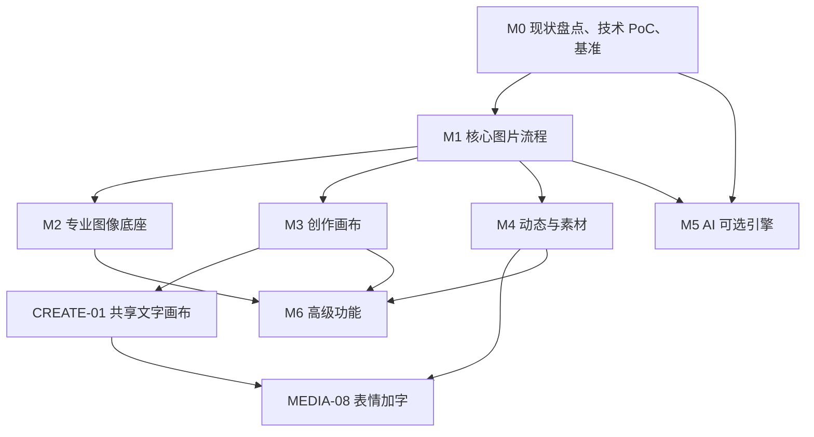

# Go 图片工具箱 · 开发路线图、工作分解与 Issue 模板

> **2026-11-17 仓库适配修订**：软件基线为 `v3.1.0`，不是本包版本号。先读 [M0 仓库对齐与增量实施基线](../04_实施与测试/M0_仓库对齐与增量实施基线.md)。本次只优化规划；源码核查、历史测试、人工验收和性能实测分别记录。

> 依据 PRD v2.0 §3、§15、附录 A，并参考技术规范 v1.0 的 M0–M6。这里是**可执行任务拆解**，源码定位与复用边界见 M0 仓库适配基线。P0/P1/P2 是需求优先级，不是按时间估出的开发工期。所有“任务完成”必须有源码、运行结果和验收证据，不能只勾选文档。

## 1. 项目执行边界

- 保留截图已显示的 14 个入口，先盘点已有实现，再针对缺陷/缺项增量开发。
- 不开发 OCR、文档新增功能、开发者工具、独立批量管理。
- Go 图像核心原生优先；AI 和视频由可选原生组件实现；保留 MyGo + Lobe MyGo，不以换壳为前置任务。
- 原有“转 PDF”冻结：不扩展新功能、不无依据删除。
- 不承诺“重写后一定更快”；每个“优化”都要有前后基准证据。

## 2. 里程碑与依赖



| 阶段 | 可交付目标 | 准出条件 |
|---|---|---|
| M0 | 已知系统/依赖/功能完成度、技术候选 A/B、测试基准和授权清单 | M0 报告经人审定、需求矩阵标注实际状态 |
| M1 | 通用导入/预览/导出、格式、裁剪、缩放、压缩和现有必需功能稳定 | P0 回归、源图保护与安全导出全通过 |
| M2 | 专业调色、曲线、LUT、滤镜、图像对比与分析 | ICC/Alpha 精度路径经验证、预览与导出一致 |
| M3 | 共享画布、布局、拼图、长图、水印、标注、截图美化、文字制图 | CJK/图层/Alpha/坐标/接缝用例通过 |
| M4 | GIF 动态编辑、图标、颜色、点阵、表情包 | 动图 disposal/时间轴、ICO 实机、严格黑白用例通过 |
| M5 | AI 引擎 + 模型管理 + GPU 检测 + 质量对照 | 许可证、模型 hash、取消清理、A/B 报告通过 |
| M6 | SVG 描摹、视频帧提取、背景素材等高级项 | 单项独立验收；不退化主功能 |

## 3. M0：现状、技术与基线（必须最先）

| 任务 ID | 范围 | 输出物 | 验收 |
|---|---|---|---|
| M0-01 | 盘点源代码、Go 版本、UI 框架、运行平台 | 仓库/模块/依赖映射 | 能从干净环境构建运行 |
| M0-02 | 对 14 个入口逐项操作与源码定位 | 实现完成度矩阵、缺陷清单 | 每项有状态与证据 |
| M0-03 | 测现有首屏、空闲内存、压缩、动图、导出 | 原始性能报告 | 包括进程与子进程 |
| M0-04 | codec 实测矩阵：静态/动画/ICC/Alpha | 格式能力表 | 读与写分别验证 |
| M0-05 | 技术 PoC：Go 图像库、ICC、动图、中文排版 | ADR 草案与性能对照 | 版本已锁定 |
| M0-06 | 外部依赖许可证、模型/字体审查 | SBOM/NOTICE 基线 | 高风险项标红阻断 |
| M0-07 | 合成测试样本与真实许可素材 | 测试图集/清单/SHA256 | 可复现来源与预期 |
| M0-08 | 固化 MyGo 生命周期与配置兼容约束 | 保留决策、旧索引迁移方案 | 无换壳、无设置丢失 |

**M0 状态**：源码盘点和历史测试/构建证据已登记。性能、实机和许可补证按受影响模块设门槛，不阻断无关维护。不得擅自迁移全部代码或宣称全部格式/平台已验收。

## 4. M1：Core 任务拆分

| Issue | PRD ID | 实现任务 | 验收/测试 |
|---|---|---|---|
| CORE-01 | SYS-01、TECH-05 | 图片头探测、格式能力注册、真实读写检测 | 错误后缀与缺插件有正确提示 |
| CORE-02 | SYS-02 | 方向、Alpha、色彩策略 | E2E-01/02/08 核心用例 |
| CORE-03 | SYS-03、UI-01 | 编辑 Session、参数快照、Undo/Redo | 连续滑动旧任务不会覆盖新结果 |
| CORE-04 | SYS-04/05 | 统一安全导出与成功页 | 磁盘满、覆盖冲突、临时文件、原图哈希 |
| CORE-05 | BAS-01 | 格式转换能力和动画分流 | 动图不静默丢帧 |
| CORE-06 | BAS-02 | Fit/Fill/Pad、插值、DPI 说明 | 尺寸与无畸变回归 |
| CORE-07 | BAS-03 | 裁剪、比率、去边、旋转 | 预览坐标与输出一致 |
| CORE-08 | BAS-04 | 画质/体积/目标大小/无损模式 | E2E-03，目标失败诚实显示 |
| CORE-09 | PRO-03 | 通用对比组件初版 | 滑杆、同步缩放、100% 细节 |
| CORE-10 | CRE-05、MED-01 | 旧批量水印/GIF 功能维稳 | 旧操作不回归、不会丢帧 |
| CORE-11 | NFR-01/03/04 | 基准、取消、错误、异常输入 | 崩溃/泄漏/源图保护阻断 |

### 4.1 Core+：BAS-05 基础编辑（P1，独立增量）

| Issue | PRD ID | 实现任务 | 依赖与验收 |
|---|---|---|---|
| EDIT-01 | BAS-05 | 旋转、翻转与操作快照 | CORE-03/07；角度边界、撤销及 Alpha |
| EDIT-02 | BAS-05 | 画布尺寸/锚点、背景、边框、圆角、阴影与透明度 | CORE-03/04、EDIT-01；尺寸、透明边缘、渲染顺序与预览导出一致 |
| EDIT-03 | BAS-05 | 基础模糊/锐化、灰度/反相、工具预设 | CORE-03、EDIT-02；复用现有库，逐项追踪 PRD 的 BAS-05 子功能清单，覆盖预设保存/重载及组合撤销 |

## 5. M2：Studio 任务拆分

| Issue | PRD ID | 实现任务 | 验收/测试 |
|---|---|---|---|
| STUDIO-01 | PRO-01 | 色阶/曲线/LUT 基础与版本化操作 | 0 值/边界/ICC 回归 |
| STUDIO-02 | PRO-01 | 曝光/高光/阴影/HSL/白平衡 | 颜色空间政策清晰、无静默偏色 |
| STUDIO-03 | PRO-02 | 滤镜集合及强度/叠加 | 0% 原样、边缘透明正确 |
| STUDIO-04 | PRO-03 | 差异图、PSNR/SSIM 与映射 | 异尺寸未对齐时禁用指标 |
| STUDIO-05 | PRO-04 | R/G/B/亮度/Alpha 直方图与像素取样 | 黑/白/单色有准确分布 |

## 6. M3：Creator 任务拆分

| Issue | PRD ID | 实现任务 | 验收/测试 |
|---|---|---|---|
| CREATE-01 | CRE-02/07 | 共享画布/图层/坐标/蒙版/文字 | 画布预览和导出一致 |
| CREATE-02 | CRE-03 | 保留 1–16 张拼图，增量模板、单格调整 | 换序/换模板不丢图 |
| CREATE-03 | CRE-04 | 连续长图匹配、手动接缝 | 低置信度保护内容 |
| CREATE-04 | CRE-01 | 宫格切图整数边界算法 | E2E-04 奇数尺寸覆盖完整 |
| CREATE-05 | CRE-05 | 批量水印模板/变量/九宫格位置 | 不同图比例、CJK、原图保护 |
| CREATE-06 | CRE-06 | 富文本制图与字体回退 | 中文段落、代码/引用正确 |
| CREATE-07 | CRE-07 | 箭头/形状/高亮/安全遮挡 | E2E-07 被遮挡像素不可恢复 |
| CREATE-08 | CRE-08 | 截图美化背景/圆角/阴影 | 边角/导出比例/透明正确 |

## 7. M4：Media 任务拆分

| Issue | PRD ID | 实现任务 | 验收/测试 |
|---|---|---|---|
| MEDIA-01 | MED-01 | GIF 复合帧/偏移/disposal 内核 | E2E-10/17 |
| MEDIA-02 | MED-01 | 帧时间轴、播放/倒序/删帧/时长 | 导出重开时间与画面一致 |
| MEDIA-03 | MED-01 | 量化、抖动与 GIF 压缩 | 文件有效与质量体积比较 |
| MEDIA-04 | MED-01 | 保留现有 APNG/动态 WebP，补齐边界矩阵 | 复用现有回归，分别核验读写、时序和预算 |
| MEDIA-05 | MED-02 | 多尺寸 ICO 与 PNG 导出 | Windows Explorer 16/32/256 层可见 |
| MEDIA-06 | MED-03 | 取色、主色提取、配色展示 | 透明像素不污染占比 |
| MEDIA-07 | MED-05 | 黑白量化与三种抖动、400×300 | E2E-11 黑白像素与 PNG 1-bit IHDR 双重检查 |
| MEDIA-08 | MED-06 | 静态/动态表情加字；依赖 CREATE-01 与 MEDIA-01/02 | E2E-12 指定帧区间文字正确 |

## 8. M5：AI 可选组件任务拆分

| Issue | PRD ID | 实现任务 | 验收/测试 |
|---|---|---|---|
| AI-01 | AI-01-01 | NCNN GPU/引擎版本探测 | 真无 Vulkan 的提示准确 |
| AI-02 | AI-01-03/09 | 模型注册、哈希、许可、安装/卸载 | 未批准权重不能预装 |
| AI-03 | AI-01-04/06 | 模型原生倍数/Tile/TTA 参数映射 | 不混淆 Upscayl 与 Real-ESRGAN CLI |
| AI-04 | AI-01-07 | 子进程生命周期与取消 | GPU/OOM/崩溃无残留 |
| AI-05 | AI-01-05/08 | 局部预览、高清输出、结果对比 | 输出尺寸、真文件、实际画质 |
| AI-06 | AI-01 | A/B 性能与发布组件审核 | 同模型同 GPU 对照与 SBOM |

## 9. M6：按需求证据选择

| 候选 | PRD 优先级 | 前置条件 |
|---|---|---|
| 黑白 SVG 轮廓描摹 | P2 | SVG Path 能真实表达、退化输入安全 |
| 彩色 SVG 描摹 | P2，可选库 | VTracer 等库许可/性能 PoC |
| 视频抽帧/故事板 | P2 | FFmpeg 许可、组件检测、PTS 规则 |
| 背景素材生成 | P2 | 确定性算法与 PNG 输出 |
| 智能抠图 | P2 | 合规模型、独立内存/包体积预算 |
| 旧照修复/对象擦除 | P3 预研 | 另行立项，不属于当前发布承诺 |
| 图像融合/堆栈 | P3 预研 | 需独立数据集与配准评估 |

## 10. Issue 模板（每一项均需填写）

```markdown
## 标题
[模块编号] 可验证的功能/修复名称

## 来源
- PRD ID：
- 依赖任务 / ADR：
- 模块：Core / Creator / Studio / Media / AI

## 现状证据
- 当前代码位置 / commit / 行为截图：
- 状态：已有可用 / 部分实现 / 缺陷 / 未实现

## 需求与非目标
- 用户场景：
- 功能输入输出：
- 参数、默认值、边界：
- 明确不做：

## 技术方案
- Go 方案、可选外部适配器：
- 色彩/Alpha/动画语义：
- 文件安全与取消机制：
- 依赖版本、授权与打包影响：

## 测试验收
- 正常场景：
- 异常场景：
- 性能/内存：
- 测试样本及 SHA256：
- E2E 用例：

## 完成证据
- PR 链接与 commit：
- UI 截图/演示：
- CI 测试结果：
- 实测结果与已知限制：
```

## 11. Pull Request 模板

```markdown
## 变更目的与用户价值

## 关联需求 / issue / ADR

## 已实现及明确未实现

## 兼容性影响
- 原有 14 个入口是否受影响：
- 旧配置迁移：
- 输入/输出格式变化：
- 外部组件/模型/字体授权变化：

## 测试证据
- 单测/集成/E2E：
- 原图哈希不变：
- Alpha、EXIF、ICC、GIF 回归：
- 性能数据（若相关）：

## 风险与回滚方案

## 截图或演示链接
```

## 12. 变更治理

- **不经用户批准不得改变范围边界**，尤其 OCR、文档、开发者工具、独立批量管理。
- 开发中如出现必需的新原生依赖、许可证限制、格式能力不匹配，先登记 ADR 和测试证据再修改设计。
- 一个 Issue 的 DoD：编译、功能、异常、回归、许可证、文档、UI、性能（适用时）均有证据。
- 每个阶段结束形成变更日志；未开发的 P1 功能不能在页面里伪装为正式可用。
