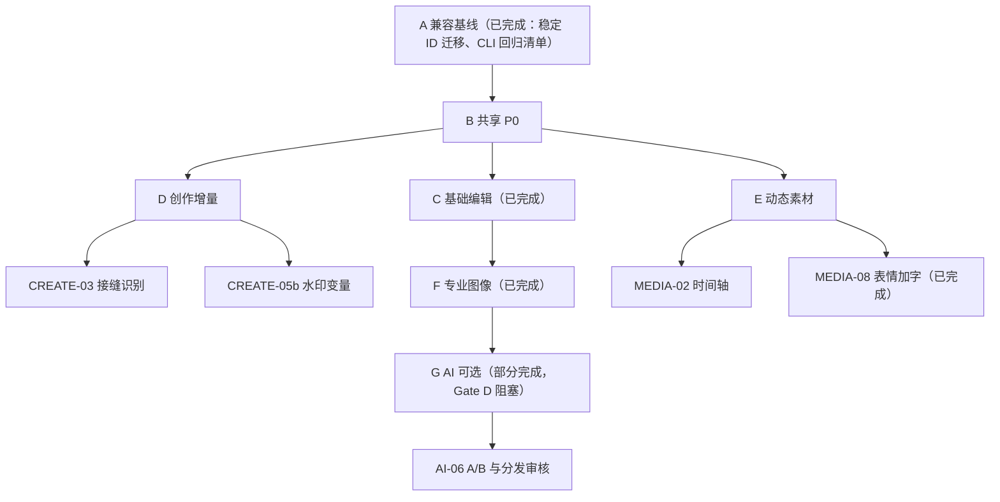

# 路线图与 Issue 计划（M1–M6 增量）

> 基线：`v3.1.0` / commit `848da45`，Go 1.27.3，MyGo + Lobe MyGo，25 个工具入口（原 14 个 + 本次新增 11 个）。
> 本文件把 M1–M6 拆成可实施 issue，列依赖与验收条件。**所有"完成"必须附源码、测试与运行证据；勾选文档不算完成。**

## 0. 本轮已交付（可直接核验）

| 需求 ID | 交付物 | 源码定位 | 自动化证据 |
|---|---|---|---|
| SYS-01 | 格式能力快照 | `internal/capabilities/capabilities.go` | `capabilities_test.go`（6 条） |
| SYS-03 | 参数快照撤销/重做 | `internal/history/history.go` | `history_test.go`（6 条） |
| BAS-05 | 基础编辑页与引擎 | `internal/engine/edit.go`、`internal/ui/tools_studio.go`（EditTool） | `TestGrade…` 系列与页面渲染用例 |
| CRE-02/07 | 自由画布 + 标注 | `internal/engine/canvas.go`、`annotate.go` | `TestCanvas…`、`TestAnnotate…`、`TestCoverDestroysThePixelsUnderIt` |
| CRE-08 | 截图美化 | `internal/engine/annotate.go`（ScreenshotRequest） | `TestScreenshot…`（2 条） |
| PRO-01 | 专业调色 + .cube LUT | `internal/engine/grade.go`、`lut.go` | `grade_test.go`（12 条） |
| PRO-02 | 滤镜库 | `internal/engine/filters.go` | `filters_test.go`（滤镜部分 7 条） |
| PRO-03 | 共享对比 + 差异图 + PSNR/SSIM | `internal/engine/compare.go` | `TestCompare…`、`TestDiff…`（4 条） |
| PRO-04 | 直方图与统计 | `internal/engine/analysis.go` | `TestAnalyze…`（2 条） |
| MED-05 | 像素画 + 真 1-bit PNG | `internal/engine/pixel.go`、`internal/png1bit/png1bit.go` | `TestStrictBlackWhite…`、`TestPixelArtWritesARealOneBitPNG` |
| MED-06 | 表情包（静态 + 动图帧区间） | `internal/engine/emote.go` | `TestEmote…`（2 条） |
| AI-01（部分） | 引擎探测、模型注册与哈希、子进程与取消 | `internal/upscale/upscale.go`、`proc_windows.go`、`proc_other.go` | `upscale_test.go`（9 条） |
| COMP-02 | 侧栏稳定 ID 与旧索引迁移 | `internal/settings/settings.go`、`internal/ui/rail_drag.go` | `rail_migration_test.go`（4 条） |
| UI-01/02 | 首页、分组导航与工具搜索 | `internal/ui/home.go`、`groups.go` | `home_test.go`（6 条）、`rail_drag_test.go`（分组与搜索用例） |
| NFR-04 | 子进程绝对路径 + 进程树清理 | `internal/upscale/proc_*.go` | `TestCancelIsReportedAsCancellation` |

## 1. 未完成项与真实阻塞

### 1.1 M1 Core 残留

| Issue | 内容 | 阻塞原因 | 验收条件 |
|---|---|---|---|
| CORE-04b | 磁盘满 / 只读目录 / 长路径的故障注入回归 | 需要受控文件系统环境（不能在本机安全模拟满盘） | 故障注入用例 + 原图哈希不变 |
| CORE-06b | Fit/Fill/Pad 三种模式在尺寸调整页可选 | 现有 `applyResize` 已支持 fit/exact，但页面只暴露弱化选项；补齐需要新增 UI 下拉与回归 | 1000×500 → 400×400 三种模式输出尺寸与内容断言 |
| CORE-08b | 目标体积搜索（±5%、有限迭代） | 未实现；需在压缩页加入目标 KB 输入与搜索循环 | E2E-03：目标达成/未达成的真实状态 |
| CORE-11b | 扩展 fuzz 与异常输入压力测试 | LUT 已执行 20 秒、460,567 次无崩溃；其他解析器仍需扩展 | 崩溃为零、错误码正确 |

### 1.2 M3 Creator 残留

| Issue | 内容 | 阻塞原因 | 验收条件 |
|---|---|---|---|
| CREATE-03 | 长图自动接缝识别（降采样预筛 + 置信度） | 算法需独立设计与样本集；现有仅顺序拼接 | E2E-06：低置信度给出提示且不删内容 |
| CREATE-05b | 水印 `{filename}/{date}/{index}` 变量 | 变量替换未实现 | 不同文件名与日期下预览与导出文本一致 |
| CREATE-06b | 富文本 Markdown 简化语法 | 现有为结构化块输入 | 标题/粗体/代码块渲染正确、CJK 不溢出 |
| CREATE-02b | 拼图拖动换序 | 现有为文件列表顺序，画布内未支持拖拽重排 | E2E-05：换序后无重复/丢图 |

### 1.3 M4 Media 残留

| Issue | 内容 | 阻塞原因 | 验收条件 |
|---|---|---|---|
| MEDIA-02 | GUI 帧时间轴（播放/倒序/删帧/改时长） | 需要新的时间轴控件与逐帧预览缓存 | E2E-10：编辑后重开帧时序一致 |
| MEDIA-07b | 像素化的 4/8/16 色调色板自定义 | 现有为均匀步长调色板 | 自定义调色板往返一致 |
| MEDIA-05b | Windows Explorer 实机层级验证 | 需要真实 Windows 桌面环境 | 16/32/256 层可见 |

### 1.4 M5 AI 残留（Gate D 未过）

| Issue | 内容 | 阻塞原因 | 验收条件 |
|---|---|---|---|
| AI-03b | 局部预览 | 尚未实现局部裁切推理与上下文处理 | 局部与整图上下文差异有明示 |
| AI-05b | 端到端输出复核（解码校验尺寸） | 适配器与双 GPU 小图、大图、透明、自然照片、方向及活动取消验证通过 | 证据见 `benchmarks/GPU-2026-11-17.md`；显存上限、透明边缘完整画质仍待补测 |
| AI-06 | A/B 性能与发布组件审核 | 未完成同条件性能对照及权重再分发审核；安装包不含 AI 引擎/权重 | 同 GPU 同模型的 P50/P95、显存、质量对照 |

### 1.5 M6 高级项（按证据选择，不承诺）

| 候选 | 前置条件 |
|---|---|
| SVG 轮廓描摹（P2） | 需真实 Path 输出、闭合/孔洞/自交验收 |
| 视频帧提取（P2） | FFmpeg 许可、组件检测、PTS 规则 |
| 背景素材生成（P2） | 确定性算法 + 无缝平铺验收 |
| 智能抠图（P2）/ 修复（P3） | 合规模型 + 独立内存预算 |

## 2. 依赖关系

## 3. 每项 Issue 的模板

沿用交付包 `04_实施与测试/开发路线图_任务拆分与Issue模板.md` §10 的模板，逐项填写：

- 标题、PRD ID、依赖、模块归属
- 现状证据（代码位置 / commit / 行为）
- 需求与非目标
- 技术方案（含色彩/Alpha/动画语义、文件安全、许可影响）
- 测试验收（正常 / 异常 / 性能 / 样本 SHA256 / E2E 编号）
- 完成证据（commit、UI 截图、CI 结果、实测数据）

## 4. 发布门槛复核

| 门槛 | 当前状态 | 说明 |
|---|---|---|
| 真实编解码矩阵可生成 | 通过 | `internal/capabilities` 与 `matrix_test.go` 一致 |
| P0 导出与源图完整性 | 部分通过 | 原子写与取消路径有回归；磁盘满注入未做（CORE-04b） |
| ICC / 透明 / EXIF / 复杂 GIF 回归 | 通过 | 既有回归 + 本次新增标注/像素化回归 |
| 第三方组件与模型许可登记 | 部分通过 | 依赖已登记；C 库版本、模型权重待补（见 `docs/licenses/COMPONENTS.md` §6） |
| 干净 Windows 安装/升级/卸载 | 云端强制门禁 | 临时 runner 执行，结果以 Actions 运行记录为准 |
| 异常输入不导致长期无响应 | 部分通过 | 资源预算、帧数上限及 LUT fuzz 已通过；其他解析器仍需扩展（CORE-11b） |
